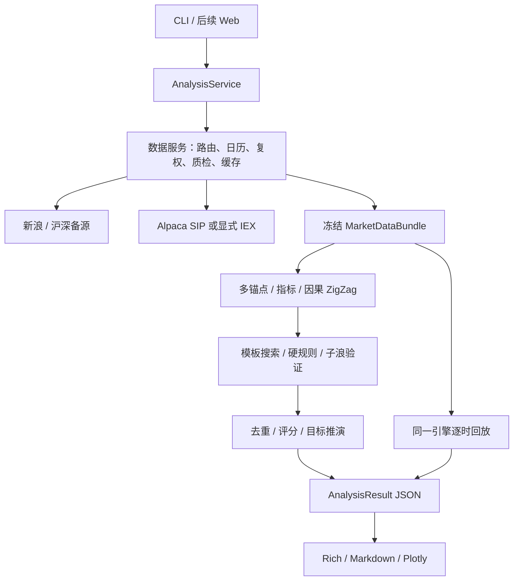

# EliotBot 详细实现方案

编制日期：2026-11-16。依据：[原始设计](../DESIGN.md)及两个参考项目当前检出的行情相关代码。

**规格与进度：** 本文保留完整目标设计；当前已实现 CLI MVP 及七种主分析周期，逐项进度、真实行情验证与未验收范围见[实现及验收状态](IMPLEMENTATION_STATUS.md)。下面未完成的后续阶段仍属于目标规格，不能仅凭本文视为已交付；实际配置以仓库根目录 `config.example.yaml` 为准。原始设计继续保留。

## 目录

1. [目标、范围与实现顺序](#1-目标范围与实现顺序)
2. [实施前固定的设计决策](#2-实施前固定的设计决策)
3. [两个参考项目的代码依据](#3-两个参考项目的代码依据)
4. [架构、目录与依赖](#4-架构目录与依赖)
5. [统一数据模型与接口](#5-统一数据模型与接口)
6. [A 股、美股数据获取方案](#6-a-股美股数据获取方案)
7. [复权、日历、数据质量与缓存](#7-复权日历数据质量与缓存)
8. [跨度选择、指标与因果拐点](#8-跨度选择指标与因果拐点)
9. [浪型模板与硬规则](#9-浪型模板与硬规则)
10. [候选搜索、去重与层级关系](#10-候选搜索去重与层级关系)
11. [可解释评分与候选权重](#11-可解释评分与候选权重)
12. [关键价位、目标区和路径](#12-关键价位目标区和路径)
13. [服务流程、CLI 与图表报告](#13-服务流程cli-与图表报告)
14. [测试、历史回放与统计验证](#14-测试历史回放与统计验证)
15. [实施阶段与交付标准](#15-实施阶段与交付标准)
16. [配置、运行与性能预算](#16-配置运行与性能预算)
17. [Web 演进方案](#17-web-演进方案)
18. [待验证事项与完成定义](#18-待验证事项与完成定义)

## 1. 目标、范围与实现顺序

程序输入股票代码，输出截至指定时点可解释的数浪候选、正在运行的浪段、结构失效条件、后续确认条件、目标价格区，以及对应的 HTML / Markdown / JSON 报告。PNG 为可选导出能力。

核心采用规则与有限搜索，先建立可复现的分析能力。首版不以机器学习识图或大模型数浪作为计算环节。

| 发布层次 | 必须交付 | 之后补齐 |
| --- | --- | --- |
| 日线 MVP，M0–M5 | 沪深 A 股与美股；已收盘日线；周线辅助寻锚；上涨/下跌推动浪、ABC 锯齿的进行中与完成态；评分、关键位、HTML/MD/JSON；离线回放 | 复杂浪型与分钟增强 |
| CLI 完整版，M6–M7 | 平台、收敛三角形、收敛引导/终结楔形；60m 辅助验证及独立主周期；周线主分析；数据能力验证后启用北交所；真实样本与回放评估 | 扩散楔形、复杂组合调整作为后续独立规则版本 |
| Web，W1–W2 | 同一引擎的任务 API、交互图、历史报告、自选股扫描 | 多用户部署按实际需求增加 |

不把券商下单、账户同步、资金管理或全市场高频扫描纳入以上交付。这里的“确认”和“失效”描述结构条件，不直接生成订单。

**首条端到端链路**：冻结日线样本 → 因果 ZigZag → 普通推动浪/锯齿 → JSON → Plotly。链路可复现之后，再接真实网络与更多浪型，避免同时排查数据、数浪和渲染三个系统。

## 2. 实施前固定的设计决策

这些是本方案提出的落地约定，不应将它们写成已经验证的程序能力。

| ID | DESIGN 对应内容 | 实施约定与原因 | 验收位置 |
| --- | --- | --- | --- |
| D01 | §5.4、§7：概率与清晰度 | Softmax 输出称“候选相对权重”；另列质量、证据覆盖率与歧义。统计概率需要定义事件并用留出样本校准 | §11、T15 |
| D02 | §5.1：已确认拐点 | 分别记录极值发生时间和反转确认时间；回放按确认时间使用，防止把后来才知道的拐点放回过去 | §8、T06 |
| D03 | §4.2：新浪短 K 线接口 | 长跨度日线采用参考项目的长历史接口思路；周线从同源日线聚合。短 K 线接口用于分钟能力，不依赖未经验证的 `scale=1200` 和固定根数上限 | §6、T02 |
| D04 | §4.2–4.3：复权 | 保存 raw 与复权依据；A 股统一到报告基准日的乘法复权坐标；美股明确采用 Alpaca `all` 的供应商口径，不做二次复权 | §7、T03 |
| D05 | §4.3：IEX/SIP | 默认美股历史分析使用 SIP、明确请求截止时刻；IEX 是显式选择的独立输入。权限失败不静默换源 | §6、T04 |
| D06 | §4.4：唯一周线锚点 | 最多保留 4 个有历史依据的锚点，分别搜索。不能把最近一次极值自动断言为浪 0 | §8、T09 |
| D07 | §4.4：30 根预热 | 默认预热 130 根主周期 K 线，记录不足情况；指标种子、预热与回放起点固定 | §8、T05 |
| D08 | §5.2–5.3：进行中浪 | 硬规则返回 PASS / FAIL / PENDING；只有证据已经违反规则才淘汰，未完成浪不得提前按最终长度判失败 | §9、T07 |
| D09 | §5.3：重叠后转楔形 | 普通推动失败后仍须独立匹配楔形模板，包括几何、内部结构与上级位置；不能仅凭浪 4 重叠改名 | §9、T08 |
| D10 | §5.4：子浪分形 | 5/9 个折返只作初筛；加分需验证子模板的顺序、端点和规则。覆盖不足返回 UNAVAILABLE | §9、T11 |
| D11 | §5.4：Top-K 概率 | 去重后在实际搜索得到的全部合格候选上归一化，再截取展示。未展示权重与未建模走势分开表达 | §11、T15 |
| D12 | §5.5：单一失效价 | 改为带方向比较符的条件列表，区分结构失效、阶段结束与确认条件；目标区也必须满足硬规则 | §12、T12 |
| D13 | §5.4：缺少部分特征 | 记录 EXPECTED / NOT_APPLICABLE / UNAVAILABLE，不能因少拿到分钟线而把剩余项目重新放大成满分 | §11、T14 |
| D14 | §4.1：市场与代码 | 前后缀只是语法识别；通过证券元信息确认身份、代码别名与数据能力，显式处理 `000001`、`BRK.B` 和 BJ | §5–6、T01 |
| D15 | §5.2：合并拐点 | 检查被跨过的全部 K 线极值；不允许通过删掉中间违规影线制造合法波浪 | §10、T10 |

## 3. 两个参考项目的代码依据

以仓库名为引用根，不让 EliotBot 运行时依赖其他开发目录或向 `sys.path` 注入参考项目。

本次读取时，`<PRIVATE_PROJECT>` HEAD 为 `<REFERENCE_COMMIT>`；`<QUANT_FRAMEWORK>` HEAD 为 `<REFERENCE_COMMIT>`。以下为本次直接阅读的实现位置；迁入前仍应核对文件版本、许可及依赖。

| 参考根 / 文件 / 位置 | 已观察到的实现 | EliotBot 采用方式 |
| --- | --- | --- |
| `<PRIVATE_PROJECT>/src/<MODULE>/scanner.py:662`，`AlpacaClient` | REST 认证、限速、请求封装；按 feed 分缓存目录 | 借鉴请求边界与缓存身份；新项目优先用官方 SDK 的薄封装 |
| 同文件 `:1102`，`get_daily_bars` | 显式 start/end/feed、`adjustment=raw`、批量请求、遍历 `next_page_token`；网络失败与旧缓存路径分离 | 迁移完整分页与出处记录思路；新项目自己的复权策略由请求契约决定 |
| 同文件 `:1202` | 旧缓存回退后不刷新缓存时间，防止旧数据伪装成新数据 | 保留；同时增加交易日覆盖检查 |
| `src/<MODULE>/market_data.py:14` | 正式 SIP 日线等待收盘后 20 分钟；检查时区、完成交易日和请求截止时间 | 复用完成交易日与延迟窗口的约束思路；不照搬“盘中禁止分析上一日”的产品限制 |
| `src/<MODULE>/market_calendar.py:124` | 会话开收盘、提前收市、最新完成交易日 | 作为边界测试参考；本项目日历服务独立封装并校验特殊休市 |
| `tests/test_sip_eod_migration.py` | SIP 正式路径、IEX 临时来源与错误路径的测试 | 参考用例范围，重写为 EliotBot 的输入/输出契约测试 |
| `<QUANT_FRAMEWORK>/quant/<MODULE_PATH>/sina.py:454` | 一次长历史请求及一次 hfq 因子请求，生成 raw/hfq 配对数据 | 提炼为 A 股 `fetch_raw_bars` 与 `fetch_adjustments`，保存原始因子而非仅保留舍入后的 hfq 价格 |
| 同文件 `:35`、`:50`、`:487` | 锁定 AkShare `1.18.94`，内部快速路径版本检查，公共接口回退 | 参考版本防护，不能直接假设该版本的内部导入适用于新版 |
| 同文件 `:217`、`:322`、`:363` | 有界重试、429/503 的 Retry-After、因子文本解析、因子与交易日期并集后前向填充 | 借鉴；因子不能反向填充；缺少首段因子需明确失败或裁剪 |
| `<MODULE_PATH>/adjust.py:28`、`:112` | 按冻结基准续接 <QUANT_FRAMEWORK> 价格，成交量为 `raw_shares / 100 / factor`，成交额缩放 | 理解该格式；波浪图不照搬这些 <QUANT_FRAMEWORK> 单位及归一化价格 |
| `<MODULE_PATH>/baostock_source.py:157`、`:189` | 串行会话、可隔离子进程与期限；显式拒绝北交所 | 作沪深数据核验/整段备源；保持能力边界和可终止性 |
| `<MODULE_PATH>/symbols.py:18`、`calendar.py:30` | 代码标准化、交易日历获取并截断到 as-of | 参考格式转换；补足后缀写法、证券身份和日历覆盖证明 |
| `tests/test_sina_fast.py:151`、`tests/test_data_ingest.py:365` | 非交易日因子变更、复权坐标尺度不变性等边界用例 | 提炼成独立手算 fixture，验证新项目自身公式 |

**不直接搬入扫描器或 <QUANT_FRAMEWORK> 引擎。** 本项目需要 OHLCV、因子、交易日历和证券身份；不需要 SEC 财报、选股策略、<QUANT_FRAMEWORK> 二进制 provider、LightGBM 或其生产发布流程。

联网核对时，AKShare 官方已采用 `stock_zh_a_hist_sina`、`stock_zh_a_hist_min_sina` 等名称。参考代码中的 `stock_zh_a_daily`、`stock_zh_a_minute` 属于旧接口名。新实现通过自己的适配层调用并锁定经 smoke 验证的版本，不能直接将旧名称与最新版安装指令拼接。[AKShare 当前行情接口文档](https://akshare.akfamily.xyz/data/stock/stock_quote.html)、[官方接口迁移说明](https://github.com/akfamily/akshare)

## 4. 架构、目录与依赖



沿用原设计包名和分层，补上输入快照、日历、复权和评估模块；采用 `src` 布局以避免测试误导入工作目录中的同名包。

```text
EliotBot/
├── DESIGN.md / README.md / docs/IMPLEMENTATION_PLAN.md
├── pyproject.toml / uv.lock / config.example.yaml / .env.example
├── src/eliotbot/
│   ├── config.py / errors.py / service.py
│   ├── schemas/       # market.py, wave.py, report.py, provenance.py
│   ├── data/          # base.py, router.py, calendar.py, quality.py
│   │                  # sina_provider.py, alpaca_provider.py, baostock_provider.py
│   │                  # adjustment.py, resample.py, cache.py, snapshots.py
│   ├── engine/        # span_selector.py, indicators.py, zigzag.py, hierarchy.py
│   │                  # templates.py, rules.py, matcher.py, scorer.py, projector.py
│   ├── evaluation/    # replay.py, events.py, metrics.py, calibration.py
│   ├── visualization/ # chart_builder.py, report_formatter.py
│   └── cli/           # main.py, console_render.py
├── tests/{unit,properties,integration,replay,fixtures}/
└── web/               # Phase 2 再创建实际服务与前端
```

依赖方向固定为 `入口 → service → data / engine → schemas`。`engine` 不联网、不读系统时钟、不写缓存、不导入 CLI/Plotly；报告层不重新计算规则或得分。`Clock`、provider、cache、renderer 通过服务构造注入。

建议运行基线 Python 3.11+，保留将来适配原设计 Python 3.10 的空间；最低版本在 M0 写入包元数据和 CI，避免支持范围悬空。

| 依赖组 | 建议组件 | 用途 |
| --- | --- | --- |
| 核心 | Pydantic 2、pydantic-settings、NumPy、pandas、PyYAML | 契约、配置、指标和时序计算 |
| US | alpaca-py | 历史行情请求；如 SDK 不暴露所需边界，集中于适配层补 REST 请求 |
| CN | AKShare + requests；BaoStock 可选 | 先用经验证的公共接口，确有性能必要再提炼直接抓取路径 |
| 存储 | 标准库 SQLite + PyArrow/Parquet | 元数据索引 + 行情列式快照 |
| 交互 | Typer、Rich、Plotly | CLI 与 HTML 报告 |
| 可选静态图 | Kaleido | 安装与浏览器运行条件在 M5 单独 smoke；不阻塞 JSON/HTML |
| 开发 | pytest、Hypothesis、ruff、mypy | 契约、性质测试与静态检查 |
| Web | FastAPI、uvicorn | W1 后增加，不进入 MVP 运行依赖 |

先自行实现少量有明确公式的 ATR/MACD，使用独立预期值核验。SciPy 等库仅在确有用途时增加，首版不引入 TA-Lib 编译依赖或其他波浪引擎。

## 5. 统一数据模型与接口

### 5.1 输入与行情

| 模型 | 必须字段与约束 |
| --- | --- |
| `Instrument` | `instrument_id, input_symbol, canonical_symbol, provider_symbol, market, exchange, currency, timezone, asset_type, listing_date?`；ticker 变更保留别名区间 |
| `AnalysisRequest` | `symbol, timeframe, as_of, start?, end?, anchor?, feed?, mode, top_k, config_version`；`as_of` 为有时区时间；纯日期按所选时段口径的完整 bar 及可用时间解释 |
| `Bar` | `bar_id, start_at, end_at, available_at?, observed_at, session_date, open, high, low, close, volume, amount?, is_final, source_revision`；时间统一 UTC，另存交易所会话日期；所有必需数值有限 |
| `AdjustmentSeries` | 因子/公司行为的生效时间、已知时间（如可得）、来源、基准、版本、原始响应 hash；禁止只存一个“已复权”布尔值 |
| `DataProvenance` | provider/feed、请求 start/end、实际覆盖、下载时间、价格/量单位、session profile、调整方式、因子 hash、schema/parser/calendar 版本 |
| `MarketDataBundle` | 同一身份与时点的 raw 日线、分析日线、派生周线、可选分钟线、质检结果、快照 hash；不允许存在超出请求时点的 bar |

关键约束：`0 < low <= min(open, close) <= max(open, close) <= high`、`volume >= 0`；`amount=None` 与 0 区分；唯一键为 `(instrument_id, timeframe, session_profile, start_at)`。只有同一键、相同内容的重复数据可直接合并。

建议 provider 契约，以下是接口规格示意，相关模型在 M0 实现：

```python
class DataProvider(Protocol):
    def resolve_instrument(self, symbol: str) -> Instrument: ...
    def capabilities(self, instrument: Instrument) -> ProviderCapabilities: ...
    def fetch_bars(self, query: BarQuery) -> ProviderBarBatch: ...
    def fetch_adjustments(self, query: AdjustmentQuery) -> AdjustmentSeries: ...

class AnalysisService:
    def analyze(self, request: AnalysisRequest) -> AnalysisResult: ...
    def analyze_bundle(
        self, request: AnalysisRequest, bundle: MarketDataBundle
    ) -> AnalysisResult: ...
```

`BarQuery.adjustment` 显式为 `RAW / PROVIDER_ALL` 等能力枚举；CN 获取 RAW 与因子交由本地复权，US 可同时获取 RAW 与供应商 ALL。provider 不支持的类型直接返回能力错误，不伪造结果。

`ProviderCapabilities` 明确市场/周期、最早可用历史、是否支持分钟、调整类型、请求期限、实际覆盖状态；能力探测和缓存按 provider 版本绑定。不能从代码格式推断某 API 一定有对应股票的历史。

### 5.2 波浪与结果

在 DESIGN 的模型上补足：

| 模型 | 增补字段 |
| --- | --- |
| `PivotPoint` | `pivot_id, extreme_bar_id, extreme_at, confirmed_at?, price, kind, state, scale, threshold_at_extreme`；`index` 仅作本次数组索引，不作持久 ID |
| `WaveNode` | `pattern, degree, direction, stage, start_pivot, end_pivot?, children, evidence_status, rule_results` |
| `RuleResult` | `rule_id, status=PASS/FAIL/PENDING, observed, comparator, boundary, reason, evidence_bar_ids` |
| `LevelCondition` | `kind=INVALIDATION/CONFIRMATION/STAGE_EXIT, side=HIGH/LOW/CLOSE, op, price, active_from, reason, coordinate_id` |
| `PriceZone` | `low, high, method, source_targets, independent_method_count, valid_while, conditional_endpoint` |
| `ScoreEvidence` | 特征值、期望值、权重、贡献、适用性/可用性、来源周期和覆盖区间 |
| `WaveScenario` | 稳定 `scenario_id`、数浪/上级方向/下一段方向、`stage` 枚举、候选权重、质量分、覆盖率、缺失证据、条件列表、子浪证据、初始为 null 的 `calibrated_event_probability` |
| `AnalysisResult` | `schema_version, run_id, result_digest, engine_version, config_hash, input_snapshot_id, as_of, market_asof, analyzed_at, status, ambiguity, scenarios, omitted_weight, search_diagnostics, warnings` |

`pattern_direction` 与 `next_leg_bias` 分开。例如，上升推动的浪 4 当前向下，完成后预期的下一段向上；不能把两个含义挤进 `direction_bias`。

沿用的 `latest_price` 明确指最新纳入分析 bar 的 close，并携带价格坐标与时间；原始收盘价另存 `latest_raw_close`。如展示盘中报价，使用独立的 `latest_quote` 对象及其 feed/时间，不将 IEX 实时报价覆盖 SIP 日线分析价格。

`status` 建议为 `OK / UNCLEAR / INSUFFICIENT_DATA / STALE_DATA / SEARCH_LIMITED / ERROR`，并单独记录 `degraded_features`。无候选、缺行情和网络错误必须是不同原因。

JSON schema 版本从 `1.0` 起；未知版本拒绝读取。价格计算使用 float64，报价显示才按证券 tick 格式化；不可提前将所有复权价四舍五入到两位。

## 6. A 股、美股数据获取方案

### 6.1 路由与证券身份

1. 标准化输入空格、大小写，接受 `600519 / sh600519 / SH.600519 / 600519.SH` 等约定写法，统一为本项目规范代码。
2. 无前缀 `000001` 在默认股票模式解释为深市股票；上证指数必须显式 `.SH` 或 `sh` 前缀。当前实现按代码范围识别指数：`SH000*`、`SZ399*`、`BJ899*`；`SH880*` 行业指数不接入。指数目前只支持日线/周线。
3. 前缀和后缀冲突直接报错；纯数字无法可靠推断时要求显式市场。BJ `4/8/920...` 等只作候选识别，再校验证券列表及历史别名。
4. 美股将 `BRK.B / BRK-B` 作为别名输入，查询 provider 证券身份后转换；不以全局字符串替换处理所有带点/横线的代码。
5. 证券元数据缺失时允许离线 fixture 中显式提供；线上不把“拿到一段数据”当作身份已确认。

实现补充（2026-11-17）：沪深京指数日线/周线已接入，来源标记为 `sina-index`、无复权；指数分钟线未启用。美股指数尚未接入，Alpaca 股票 API 不提供 SPX/NDX 这类指数本身。

### 6.2 A 股主链路：新浪长历史日线 + 因子

日线与因子分开获取，统一复权以后在本地生成周线。避免为周线、日线和分钟线分别拿到不同时间下载的复权坐标。

M1 先使用经锁定版本的 AKShare 公共日线接口。按当前官方命名，对应 `stock_zh_a_hist_sina(symbol=..., period="daily", start_date=..., end_date=..., adjust="")` 和 `adjust="hfq-factor"`；它们是实现时需 smoke 的调用规格，而非本次已跑通结果。保留自己的兼容层，旧版适配器映射到参考项目所用旧名称。

读取 5 年左右日线作为周线寻锚输入，必要时含更早预热区；实际存在的上市历史不足则返回真实覆盖，不能循环请求同一短窗口假装补齐历史。只有在数据量、依赖或速度证明确有需要后，才迁入 `hisdata_klc2/klc_kl.js + hfq.js` 的直接解析路径。

若迁入快速路径，应满足：解码器来源和版本固定；输入解析不执行网络返回的任意 JavaScript；保存 raw/factor 响应摘要；新旧解析路径对冻结样本一致；解析变化时更新 `parser_version`。不照搬参考代码中按 OHLCV 值跨日期 `drop_duplicates` 的兼容行为，本项目只按时间身份去重。

### 6.3 A 股分钟、备源与北交所

60m 数据只请求未复权价格，再按每个会话日期对齐日线因子。默认尝试覆盖最近 90 个交易日，但以返回结果为准。新浪分钟文档只描述近期覆盖，所以“稳定拿到 60–90 日”必须作为 M1/M6 的实测门槛。[AKShare 新浪分钟接口说明](https://akshare.akfamily.xyz/data/stock/stock_quote.html)

分钟辅助采用三级结果：完整覆盖最近两段 → 验证；只覆盖其中一段 → 仅验证该段；均不足 → `subwave_status=UNAVAILABLE`，日线分析继续并扣除未获证据贡献。日线细尺度 ZigZag 可补充结构证据，但不得标成已取得 60m 证据。

BaoStock 用于沪深抽样核验、除权参考价/状态补充，或用户显式允许后的**整段替换**。原源与备源重叠区价格、单位、因子有可接受证据后才启用；更换来源产生新快照，不能逐根悄悄拼补。其会话串行执行，网络调用如无法可靠终止则用有 deadline 的子进程隔离。

参考代码显式不支持 BaoStock 的 BJ 数据。北交所个股先完整支持路由与错误说明，在新浪日线、因子、分钟和代码变更完成 smoke 后逐项启用；仅有日线时可提供注明能力限制的日线分析，不能宣称完整支持。BJ 指数（`899*`）已通过新浪指数日线接入，当前支持日线/周线。

### 6.4 美股：Alpaca SDK 适配器

优先封装 `StockHistoricalDataClient.get_stock_bars(StockBarsRequest(...))`；`BarSet` 转换仅在适配层发生。[Alpaca SDK 历史行情接口](https://alpaca.markets/sdks/python/api_reference/data/stock/historical.html)

| 参数 | 默认及行为 |
| --- | --- |
| `feed` | 历史分析默认 `sip`；`iex` 必须显式指定，记录局部交易所口径 |
| `adjustment` | 分开获取 raw 与 `all`；`all` 直接作为供应商定义的分析价格，不再应用本地因子 |
| `start/end` | 永远显式传递；本项目内部使用 `[start,end)`，适配层转换供应商的包含边界并再次本地裁剪 |
| 延迟权限 | 默认 `end <= now - 20min`；20 分钟是参考实现的保守余量，实际 entitlement 在 doctor/smoke 中确认 |
| 分页 | 验证 SDK 实际取得全部页；REST 补充路径遍历 page token，防止重复 token 死循环、部分页伪装完整成功 |
| 周线 | 从已验证、同坐标日线派生；不另取一套周线调整口径 |
| 60m | 请求同一 feed 与调整策略的分钟数据，保存真实 bar 起止和交易时段定义 |
| 认证 | 标准环境变量 `ALPACA_API_KEY / ALPACA_API_SECRET`，兼容 DESIGN 的 `ALPACA_SECRET_KEY`；同时设置且值冲突则报错 |

官方区分 Basic 的 IEX 实时覆盖与历史最近 15 分钟限制；SIP 和 IEX 也代表不同市场范围。因此“免费默认 IEX”不能替代历史分析的显式 feed 决策。权限出错明确返回 `SOURCE_FORBIDDEN`，不自动换 feed。[Alpaca 数据订阅说明](https://docs.alpaca.markets/us/docs/about-market-data-api)

批量 bars 可能先返回某一个 symbol 的多页数据，不能按单页是否出现全部 symbol 判断完成。[Alpaca 批量历史 bars](https://docs.alpaca.markets/us/reference/stockbars)

`asof` 是证券代码映射日期，不是“仅按那天已知公司行为复权”的开关。回放数据时点约束需由快照/公司行为层完成。[Alpaca 单标的历史 bars 参数](https://docs.alpaca.markets/us/reference/stockbarsingle-1)

### 6.5 时段口径

A 股日线按交易所会话；分钟聚合显式跨过午休，禁止把午休拼成一根连续小时。60m 的四段如何对应原始供应商时间标签，由分钟样本确定并写入 adapter 测试。

美股首版日线采用供应商原生日线口径，标记 `session_profile=provider_native_daily`。不擅自称其为 09:30–16:00 的 RTH 日线。分钟辅助记录自己的实际时段覆盖；若无法覆盖父浪关键极值或聚合规则不兼容，就不能出具该段的分形通过结论。Alpaca 对日线和分钟线的交易条件聚合存在区别，因此不能假定分钟聚合一定逐位等于原生日线。[Alpaca 行情聚合说明](https://docs.alpaca.markets/us/docs/market-data-faq)

**访问延迟与 K 线完成是两件事。** 默认的 20 分钟 buffer 解决历史请求权限，不证明 16:20 的供应商原生日线所有字段都已完整；盘后交易仍可能更新原生日线成交量。时段 profile 必须分别给出交易所常规收盘、bar 聚合结束和供应商可用时刻。在尚无更精确的已验证截止规则时，US 原生日线保守等到其纽约日期结束后再加访问 buffer 才标为 final；提前分析当日则标 provisional。该策略是本项目提出的保守默认，并非供应商承诺的发布时间。[日线成交量与盘后条件规则](https://docs.alpaca.markets/us/docs/market-data-faq)

如后续提供纯 RTH 日线，应从相同时段的细周期数据独立构造，使用新的 session profile 与缓存身份，不能与供应商原生日线交替使用。独立 60m 主分析按市场开盘锚定聚合；美股尾段可不足 60 分钟，标记实际时长。

## 7. 复权、日历、数据质量与缓存

### 7.1 A 股分析坐标

设 `H(t)` 是经过验证的新浪累计后复权乘法因子，`a` 是本次报告的价格基准会话，默认最新已完成会话：

```text
F(t; a) = H(t) / H(a)
analysis_OHLC(t) = raw_OHLC(t) × F(t; a)
analysis_OHLC(a) = raw_OHLC(a)
```

这是 EliotBot 明确定义的基准日复权坐标。因子方向、是否与供应商原生 qfq 等价须用 fixture 和抽样确认，不混用未经验证的其他因子。分钟 OHLC 使用所属 session 的 `F(t; a)`，周线从复权后的日线聚合，保留 float64。

因子按生效日期做向前延续；先取行情日期与因子日期并集再填充，避免丢失非交易日生效事件。首个行情日前没有可用因子时，返回缺证据，不能从未来向后填充；确认没有公司行为且依据完整时才可按已验证约定设为 1。

原始成交量统一存“股”、成交额存本币；不随现金分红价格因子缩放，也不套用 <QUANT_FRAMEWORK> 的 `shares / 100 / factor`。有独立拆股/送股证据时另建 `split_adjusted_volume` 用于跨事件量比；否则跨股本变化的量比特征返回 UNAVAILABLE，不能用现金分红因子猜拆股比例。美股分析量使用 Alpaca 所返回的对应调整字段，并单独保留 raw。

手算验收样例：拆股前 raw close=100、`H=1`，拆股后 raw close=50、`H=2`；基准在拆股后，则复权 close 均为 50。分钟同日使用相同系数。两个交易日即使 OHLCV 完全相同仍必须保留两行。

### 7.2 复权与历史回放边界

公司行为、数据更正或因子重发布会改变历史坐标。缓存和结果必须带 `adjustment_basis_date + factor_hash + price_coordinate_id`，因子改变时重算受影响价格、指标、拐点、评分和所有价位。

区分两类回放：

- `FROZEN_DATA_REPLAY`：对一份冻结历史数据逐前缀运行，用于检验算法因果性；不能因此声称历史数据当时就可取得。
- `POINT_IN_TIME_REPLAY`：使用当时留存的 raw/factor/公司行为版本及可用时间，才能评价实际历史可得信号。

仅用今天下载的 `adjustment=all` 或最新因子，再截到过去某天，不足以证明 PIT。即使纯乘法基准变化不改比例，供应商更正、现金调整方法、实体映射也可能改变输入。正式向前观察从开始运行之日起保存不可变快照。

### 7.3 交易日与完成状态

日历服务提供 `sessions_between`、`session_open/close`、`latest_completed_session(as_of)`、`latest_analyzable_session(as_of, profile)`、`bar_is_final`，并记录数据覆盖与版本。常规交易完成日与当前 profile 的最终可分析日分别求值；两者可能不同。美股处理 DST、节假日和提前收盘；A 股处理休市及午休。日历未覆盖目标日期时返回 `CALENDAR_UNAVAILABLE`，不能拿工作日近似生成正式结果。

默认只使用已完成且按来源规则已可用的 bar。盘中执行日线分析时正常分析最新可分析会话，并显示 `market_asof`；若显式启用未完成 bar，整份结果标为 provisional，进入独立快照命名空间。正在形成的周线不参加“已确认周线锚点”选择。`is_final` 表示约定聚合窗口已结束，不表示供应商以后绝不更正；修订始终产生新输入版本。

停牌/无交易会话与下载缺数分开记录。不向 OHLCV 注入虚构平价 K 线；有可信停牌证据时保留间隔并降低连续性评价，未知内部缺口则阻止覆盖该区间的严格子浪认证。持有期、过期时间和确认事件的日期使用共享交易日历，不用某只股票现有行数代替。

### 7.4 质检与失败策略

| 检查 | 处理 |
| --- | --- |
| NaN/Inf、非正价格、OHLC 次序错误 | 原始记录隔离；主分析需要的区间不完整则 `INSUFFICIENT_DATA` |
| 同时间同内容重复 | 按时间身份去重，记录数量 |
| 同时间冲突修订 | 留下版本及出处，按明确修订策略选一份；历史快照保持不变 |
| 不同日期相同 OHLCV | 保留，禁止跨日期按值删除 |
| 未来 bar / 未完成 bar | 按请求边界裁剪；额外记录供应商越界情况 |
| 主日线末端不是预期完成会话 | 已知停牌可标明陈旧分析；未知缺失为 `STALE_DATA`，不冒充今日结果 |
| 除权处异常跳变 | 检查 raw 与因子/公司行为；不能机械过滤所有大缺口，真实行情跳空仍保留 |
| 分钟不足或量字段缺失 | 日线继续，具体特征标 UNAVAILABLE，报告说明缺失范围 |
| 429/暂时 5xx/超时 | 有界退避、jitter、Retry-After 与总期限；重试预算耗尽返回错误 |
| 401/403/代码不存在 | 不反复重试；给出认证、权限或身份错误 |

### 7.5 缓存、快照与报告身份

SQLite 只存索引、覆盖区间、质量状态、hash 与抓取时间，Parquet 存不可变行情块；临时文件写完校验后原子改名，最后提交索引事务。并发相同请求用 key lock，避免半文件及重复下载。

```text
cache_key = hash(
  instrument_id, provider, feed, timeframe, session_profile,
  requested_range, raw_or_adjusted, adjustment_basis_date,
  factor_hash, parser_version, calendar_version, schema_version
)
analysis_key = hash(input_snapshot_id, request, engine_version, config_hash)
```

raw 缓存不需要虚构 factor hash，派生缓存必须带因子身份。覆盖起止日期、内部缺口、最终状态必须同时合格，TTL 合格本身不表示数据足够新。默认增量更新带少量重叠会话以捕捉供应商修订，更新生成新块，不覆盖已引用快照。

允许 `--offline` 使用指定快照；允许显式陈旧分析但必须返回 `STALE_DATA` 和原始 `market_asof`。网络失败不得仅改 mtime 把陈旧数据刷新成新数据。IEX/SIP、raw/all、原生日线/RTH、live/replay 分离缓存。

`run_id` 每次执行唯一；`result_digest` 对确定性业务结果计算，排除运行时间和耗时；同快照、请求、代码和配置必须得到相同 digest。只有文件全部写完并校验通过，才更新该输入身份的 `latest.json` 指针；错误结果不顶替最近成功报告。

## 8. 跨度选择、指标与因果拐点

### 8.1 多锚点跨度

1. 读取约 5 年日线并聚合完整周线，周线 ATR ZigZag 使用 `k=4.0`。
2. 只取 `confirmed_at <= as_of` 的周线极值；候选离当前 60–600 根日线。保留最近两个 LOW 与两个 HIGH，最多 4 个锚点。
3. 将周线极值映射回产生该 high/low 的真实日 K 日期；不能把周末标签当作浪起点。等价极值优先最早出现，保持稳定。
4. 每个锚点前取最多 130 根主周期预热；正式波浪标签从锚点开始。原始历史不足记录 `warmup_truncated`。
5. 若没有符合条件的锚点：在明确的 252 根会话窗口做有标记的 fallback；上市历史少于最低要求则 `INSUFFICIENT_DATA`，不伪造“重要历史底”。
6. 显式 `--anchor` 优先；显式 `--start/--end` 限制正式分析范围，可向前取预热但不能使用结束后的数据。用户给定锚点违反规则时输出失败原因。

默认日线搜索区间最长 600 根，指标预热不计入该限制。5 年是宏观背景，不意味把所有 5 年日线都作为一个浪级。分钟线只验证其实际覆盖到的最近两段。

独立周线主分析使用周线指标和周线预热，再以日线为次级证据；独立 60m 主分析使用市场会话锚定的 60m 数据，子级证据为更细周期或该周期的细尺度结构。三者沿用同一接口，数据能力和预算分别配置。

| 主周期 | 寻锚背景周期 | 次级证据 | 跨度与预热单位 |
| --- | --- | --- | --- |
| 1d | 完整 1w | 60m 或日线细尺度 | 日 bar / 交易会话 |
| 60m | 完整 1d | 5m/15m 或 60m 细尺度 | 主 60m bar；另存实际会话耗时 |
| 1w | 完整 1mo | 1d | 周 bar；日历统一映射到交易会话 |

60–600、130 等首批默认值针对日线；M6 在周期 profile 中显式声明其他主周期的值与所需历史，不能把“60 根周线”误写为“60 个交易日”。

### 8.2 指标的确定性约定

```text
TR(t) = max(high(t)-low(t), |high(t)-close(t-1)|, |low(t)-close(t-1)|)
ATR14 首个值 = 前 14 个有效 TR 的算术均值
ATR14(t) = (13 × ATR14(t-1) + TR(t)) / 14
EMA_n(t) = α × close(t) + (1-α) × EMA_n(t-1), α=2/(n+1)
DIF = EMA12 - EMA26
DEA = EMA9(DIF)
HIST = 2 × (DIF - DEA)
```

EMA 固定使用首个有效观测作递推种子，保留预热区，并在种子版本中记录；首根 TR 没有前收时使用 high-low。Volume MA 默认 20 根。RSI 暂作展示，不重复纳入相近动量评分。

所有窗口仅向后看，不使用 centered rolling、未来峰值或双向填充。不可跨越未知缺口无声重置/续算；有可信无交易状态的间隔可按已有有效 bar 计算，但时间比较仍用市场会话。

### 8.3 ZigZag 状态机

采用三个主尺度 `k={1.4, 2.4, 3.8}`，分别执行单向扫描；这三个参数是不同灵敏度，不自动等同于严格嵌套的 Elliott 浪级。

状态为 `INIT / UP / DOWN`。跟踪候选极值 `e`、极值所在 bar，以及当时已经可计算的 `ATR14(e)`。首版反转阈值定义为：

```text
threshold(e) = max(k × ATR14(e), 2 × tick_in_analysis_coordinate(e))
UP：新 high 更新 e；后续 bar 的 close <= high(e)-threshold(e) 时确认 HIGH
DOWN：新 low 更新 e；后续 bar 的 close >= low(e)+threshold(e) 时确认 LOW
```

阈值在极值更新时重设，极值不变时保持；不使用未来重算 ATR 去移动旧阈值。这比原设计只写 `ATR(t)` 更具体，作为 `zigzag_v1` 冻结，之后比较其他口径需新版本。

INIT 跟踪已见高低点，首次反转满足阈值时确立首个方向和起点；同根发生双向歧义时延迟判定并记录。首个未经反转证实的边界点保留 `SEED` 标记，不当作完整已确认结构。

**OHLC 的先后顺序规则**：一根 K 线如果既刷新极值又满足反向收盘，无法仅凭 OHLC 还原极值与反转先后。首版选择先更新极值，本根不再确认反转，等待下一根；每根最多确认一个拐点，不能编造 high→low 的盘内路径。

每个 pivot 保留 `extreme_at` 与 `confirmed_at`；`extreme_at` 仅定位极值所属 bar，不声称知道该 bar 内逐笔极值的精确时刻；`confirmed_at` 至少为反转 bar 的结束时刻，实际使用还受数据可用时间限制。图上标签可位于极值日期，分析可用时间必须满足确认与可用条件。末端为单独的 `DEVELOPING` tip，只能在当前未完成浪中使用，不能写进 `completed_waves`。

确认后的 pivot 在**固定输入版本**中不可被未来 bar 改写；发生历史数据修订则生成新输入版本，旧报告保留。相同极值保留较早时间以减少标签漂移。常数价格、ATR 为零与最小 tick 都有确定输出。

## 9. 浪型模板与硬规则

### 9.1 模板描述与阶段

模板用声明式 `PatternTemplate` 表示：允许端点序列、方向、已知前缀、未完成段、硬规则列表、预期子结构、允许上级位置、评分 profile、projection handler。

| 模板 | 正式支持阶段 | 子结构与上下文 |
| --- | --- | --- |
| 普通推动 | W2/W3/W4/W5_DEVELOPING、COMPLETE；W1 仅为弱结构线索 | 目标结构 5-3-5-3-5；父方向与正在运行段方向分开 |
| 锯齿 ABC | B_DEVELOPING、C_DEVELOPING、COMPLETE | 5-3-5；缺 A/B 的内部证据时为形态候选，不能声称已验证子浪 |
| 规则/扩散平台 | B_DEVELOPING、C_DEVELOPING、COMPLETE | 3-3-5；按 B、C 与 A 的端点关系分型 |
| 收敛三角形 | D_DEVELOPING、E_DEVELOPING、COMPLETE | 3-3-3-3-3；首版限 contracting，浪 4/B 等父级位置需证据 |
| 收敛引导楔形 | W4/W5_DEVELOPING、COMPLETE | 允许结构 profile 明确配置，上级浪 1 或锯齿 A 的位置需证据 |
| 收敛终结楔形 | W4/W5_DEVELOPING、COMPLETE | 3-3-3-3-3；上级浪 5/C 的位置需证据 |

上述 5-3-5、3-3-5 等是子结构目标，不是只数 ZigZag 笔数。参考理论对引导楔形的内部细分存在不同描述，必须在规则 profile 中明示取舍，不能让“允许重叠”变成通用豁免。[锯齿说明](https://www.elliottwave.com/waveopedia/zigzags/)、[平台说明](https://www.elliottwave.com/waveopedia/flats/)、[楔形说明](https://www.elliottwave.com/waveopedia/elliott-wave-pattern-diagonals/)

三角形的父级位置不能由三角形本身推断；没有父级证据只报告“收敛三角形形态候选 / parent_context=UNKNOWN”。扩散楔形、running flat、截短五浪及 W-X-Y 组合调整先返回未覆盖的复杂结构，随后单独版本化增加。

实现补充（2026-11-18）。端点级 `TRIANGLE / FLAT / DIAGONAL / WXY` 模板已接入。三角形支持收敛和扩散两种轨道。楔形采用收敛、非截短的端点模板。深度 2 的子浪存在性检查以同一个父浪段为边界。子结构与父级位置认证范围见当前实现状态。

### 9.2 用一个方向公式覆盖涨跌

令 `s=+1` 表示向上推动，`s=-1` 表示向下推动，`q_i=s×P_i`。正常非截短推动在 q 坐标中：

```text
时间严格递增；相邻方向交替
q1 > q0
q0 < q2 < q1
q3 > q1
q1 < q4 < q3
q5 > q3               # 首版普通、非截短推动的模板约束
L1 = q1-q0; L3 = q3-q2; L5 = q5-q4
L3 >= min(L1, L5)    # 完成态的浪 3 非最短条件
```

普通推动不重叠、浪 3 必须推动越过浪 1 等规则，不能只靠原设计的三条端点不等式替代完整模板。按现金股票市场的普通推动定义实现。[推动浪规则说明](https://www.elliottwave.com/waveopedia/impulse/)、[驱动浪规则说明](https://www.elliottwave.com/waveopedia/motive-waves/)

数值比较 epsilon 为 `max(1e-10, 1e-10×price_scale)`，不得用 ATR 容差掩盖真实越界。等长边界按上述数学定义允许，附 `boundary_case`；若未来采用更严格理论 profile，需变更规则版本。价格恰触普通推动浪 1 边界按重叠处理，不靠显示四舍五入判定。

规则检查对象还包括各浪覆盖的完整 OHLC 极值区间。比如上涨浪 4 内任何低点进入浪 1 区域都不合格，即使搜索器挑出的 P4 端点恰好在其上方。

### 9.3 进行中约束与第五浪上限

W3 尚在延伸时，其当前长度小于 W1 并不构成“浪 3 最短”；结果为 PENDING。W4 已开始、W3 已确认后，才可得到固定 L3。

当 `L3 < L1` 且 W5 正在运行时，保留边界 `q5 <= q4+L3`。上涨对应上限 `P4+L3`，下跌对应下限 `P4-L3`。tip 一旦越过，当前计数失败；目标推演不能越过此边界。`L3 >= L1` 时没有由这条规则推导出的有限 W5 上限。

手算示例：`P0..P4=[100,130,115,139,131]`，则 `L1=30,L3=24`，上涨 W5 上限为 155。P5=154 合格，P5=156 时浪 3 短于浪 1 和浪 5，该计数失败。镜像下跌例应得到相反方向的同一结论。

### 9.4 调整浪与楔形约束

对向下调整令 `A=P0-PA>0`、`B=PB-PA`、`C=PB-PC`，向上调整对称处理：

- 锯齿：`0 < B/A < 1` 为端点约束；完整非截短 C 越过 A 终点；A、C 的内部驱动结构另验。理想 0.382/0.618 等只影响评分。
- 平台：本项目 profile 以 `B/A >= 0.90` 定义最低回撤门槛；规则平台/扩散平台根据端点关系分型。1.382 等经验比率不作为普遍铁律的上界，极端偏离可降分或进入复杂结构。
- 三角形：A-C-E 一侧、B-D 一侧组成收敛边界，重叠交替且两条边界间距随时间减小；父级位置与五个调整子结构分开核验。允许 E 未触边的 profile 明确记录，不能仅画五个点就认证三角形。[三角形结构说明](https://www.elliottwave.com/waveopedia/triangles/)
- 楔形：独立检查驱动进展、反向浪未完全吞没前一驱动浪、浪 3 非最短、允许的浪 1/4 重叠、轨道收敛和子结构；上下轨不应在已观察区间提前交叉。引导/终结类型还需父级位置证据。

上下文或分钟子结构缺证据使用 `PENDING / UNVERIFIED`，与已证伪的 FAIL 区分。一个普通推动 FAIL 不会使独立的 ABC 或楔形候选自动失败或自动通过。

## 10. 候选搜索、去重与层级关系

### 10.1 有限搜索

对每个锚点、尺度、方向构建时间有向无环图。pivot 为节点，相邻方向与区间极值满足条件的浪段为边；边缓存起止时间、长度、会话数、原始 bar 极值、量均值、MACD 极值和内部缺口。

允许跨 1、3、5 个 pivot 间隔合并成一段，即跳过偶数个内部节点，保留方向交替。端点须确为覆盖区间的对应极值，内部影线不可越过相关规则边界；不以“跳过违规点”通过硬规则。

搜索使用逐段 CSP + beam：每扩展一个端点立即检查可判定规则；已 FAIL 路径停止；尚无足够端点为 PENDING。初始预算建议每个 `(anchor,scale,direction,template,stage)` beam=128，全请求扩展最多 50,000 个状态，单条路径最多 6 个主要端点，三角形为 6 个端点含起点；节点预算包含子结构搜索。

子结构递归默认最多向下 2 层，各层区间必须严格缩小；到达深度上限仍缺证据时标 UNVERIFIED，不继续无界枚举，也不把截断当作子浪通过。

按乐观得分上界、较少未验证项目、pivot 时间与模板 ID 作稳定排序；不使用目标未来是否命中作为搜索顺序。缓存键包含端点、方向、模板、级别、已知时点和输入 hash。

达到节点上限返回 `search_truncated=true` 与 `SEARCH_LIMITED`，保留已得到的结果及预算；结果不称为“穷举全部数浪”。限制性搜索造成的未知结构不能被解释成已覆盖的低概率事件。

### 10.2 当前相关性

进行中候选必须从最后一个完成端点一直解释到最新有效 tip；不能拿几个月前的一个五浪说它是“当前第五浪”。完整浪候选之后的价格必须能作为下一浪的已观察前缀，否则仅作历史背景，不进入当前 Top-K。

定义 `max_unexplained_tail_bars=0`：当前展示候选不留未解释尾部；对数据缺口用质检状态表达。过老的小级别结构和覆盖比例不足的候选降级为背景。

### 10.3 去重和层级

去重键包含方向、模板、阶段、主浪级和关键 pivot 的时间/价格身份。不同尺度的相同结构保留一份主候选，并合并“在哪些尺度被发现”的证据，不把重复发现乘成额外权重。

近似重复用已配置的端点时间邻域、ATR 标准化价格距离和关键失效条件比较；邻域是去重策略，不改硬规则的 epsilon。合并方法确定性，不能将上级推动与下级回调合成一个互斥类别。

`WaveNode.children` 只在真实包含关系和子模板已验证时建立；不同尺度 ZigZag 不天然嵌套。相容父/子结构用于解释，竞争的同级计数用于排名。所有候选的相对权重仍不代表事件互斥概率。

## 11. 可解释评分与候选权重

### 11.1 特征和可用性

实现版本说明（2026-11-17）：原 DESIGN 的第五浪比率表作为 `ew_score_v1` 保留。当前默认 `ew_score_v2` 使用浪 5/浪 1 与浪 5/浪 3 两套关系取较优拟合，sigma=0.15；浪 1 基准的核心集合为 `{0.618,1,1.618,2.618}`、次优集合为 `{0.382,4.236}`，浪 3 基准的核心集合为 `{0.618,1,1.618}`、次优集合为 `{0.382,2.618}`，次优权重均为 0.7。其他评分特征与硬规则保持共用。profile 参与配置摘要；v2 的算术验证不构成预测优越性或概率校准证据。

保留 DESIGN 的 40/25/20/15 分组，以独立特征贡献组成：

| 分组 | 内容 | 实施约定 |
| --- | --- | --- |
| 斐波那契 40 | 已完成浪的回撤/延伸实测比率 | 沿用原设计高斯核和比率表，按模板与阶段配置适用项目；不拿推演目标反过来加分 |
| 动量/量价 25 | 浪 3 动量、浪 5 背离、调整缩量 | 固定使用带方向的 DIF 峰值，Histogram 作展示或独立 profile；不挑表现更好的指标 |
| 交替/通道 20 | 深度与耗时交替、通道误差 | 会话数衡量耗时；距离除以同期 ATR 或通道宽度归一化 |
| 子结构 15 | 次级模板匹配、父子端点/方向一致 | 仅奇数笔不足以得满分；按实际覆盖区间和规则结果计分 |

浪 3 动量比较只使用 as-of 已有且该阶段适用的浪段；浪 5 背离需要价格已经越过浪 3，不能在浪 4 时预先给未来背离加分。量价跨口径或股本突变时返回 UNAVAILABLE。

通道在 W3 完成后用 P1-P3 与过 P2 平行线估计 W4；W4 确认后用 P2-P4 与过 P3 平行线推演 W5。拟合与验证端点分开，不能用 P4 拟合再以 P4 距离为零加分。[通道构造依据](https://www.elliottwave.com/waveopedia/channeling/)

每个模板和阶段有固定 feature profile：不该出现的未来特征为 NOT_APPLICABLE，应该能测但缺数据为 UNAVAILABLE。设适用集合为 E、可用集合为 A、分值权重为 `w_j`、归一特征为 `f_j∈[0,1]`：

```text
coverage = sum(w_j for j in A) / sum(w_j for j in E)
fit_score = 100 × sum(w_j*f_j for j in A) / sum(w_j for j in A)
quality_score = 100 × sum(w_j*f_j for j in A) / sum(w_j for j in E)
              = fit_score × coverage
```

空集合返回不可评分；UNAVAILABLE 不当作反证，但贡献为 0 且保留在适用分母；NOT_APPLICABLE 不进入分母。`ScoreBreakdown` 同时显示原分组贡献和阶段归一值，不能无说明相加出另一套总分。

建议初始候选门槛：质量分≥40、coverage≥0.70、有两类独立证据；最高质量分<45 时 `UNCLEAR`。这些是待 M0 冻结、M7 评估的工程初值，不是已优化阈值。清晰度综合质量、覆盖、计数差异和搜索完整性，不由第一候选权重>60%单独决定。

### 11.2 权重与不确定性

在去重和门槛筛选后的实际候选集合 C 上，用稳定 Softmax：

```text
z_i = (quality_score_i - max(quality_score_C)) / tau
relative_weight_i = exp(z_i) / sum(exp(z_j), j in C)
tau = 12.0
```

然后按 Top-K 展示；`omitted_weight = 1 - sum(displayed relative_weight)` 只表示未展示的已枚举候选权重，**不能称为未建模走势概率**。没有合格候选时返回空列表和 `UNCLEAR`；只有一个候选时其相对权重可以为 100%，同时仍须显示质量与证据不足情况。

报告使用“质量 68/100；证据覆盖 85%；候选权重 54%”三列，不把最后一项展示为“上涨成功率 54%”。正负方向候选可能预测不同阶段、不同期限或相容事件，因此也不能直接按权重求和成上涨概率。

### 11.3 未来校准

M7 先收集按固定规则定义的事件：“报告后 20/60 个交易会话内，是否先触及第一目标区而未先触发结构失效”。候选有明确有效期；没有失效条件、端点过于依赖动态 tip 或事件无法定义时不进入校准样本。

同一根 OHLC 内同时触及目标和失效视为时序未知，优先用确有覆盖的更细数据解释，否则单独统计歧义，不能默认目标先到。缺未来覆盖为右删失，不当作失败。

事件预测是每个固定事件的二元概率；相容剧本的事件概率不要求加和为 1。具备时间隔离的训练/校准/测试集、足够正负例并通过 Brier score、可靠性图和样本区间评估后，才增加 `calibrated_event_probability`；初版为 null。Softmax 温度本身不完成这项校准。

## 12. 关键价位、目标区和路径

### 12.1 条件而非单一数字

| 阶段 | 结构失效 | 确认 / 阶段结束 | 推演依据 |
| --- | --- | --- | --- |
| 上涨 W2 | `LOW <= P0` | 后续 `HIGH > P1` 确认驱动进展；弱确认可另列趋势线条件 | 暂定 P2 加 `{1,1.618,2.618}×L1` |
| 上涨 W4 | `LOW <= P1` | `HIGH > P3` 为越过 W3 的确认，较近突破另作弱条件 | 暂定 P4 加 `{0.618,1}×L1` 和 `{0.382,0.618}×(P3-P0)` |
| 上涨 W5 | 当 L3<L1 时 `HIGH > P4+L3` 否定当前计数 | 跌破 P4 是当前 W5 上行阶段结束信号，不能倒推已完成五浪从未存在 | 斐波那契 + W5 通道，受长度上限约束 |
| 向下锯齿 B | `HIGH >= P0` 否定该锯齿 B 计数 | `LOW < PA` 是 C 驱动进展条件 | PB 减 `{1,1.618}×A` |
| 向下锯齿 C | C 进行中若越过已确认 PB 则当前 C 阶段计数失效 | C 末端反向结构需新的 pivot 确认 | 等长/扩展投影，与已观察 tip 动态区分 |

下跌推动/向上调整通过方向归一公式镜像。所有 comparator 在分析坐标中求值，必要时显示换算后的当前 raw 参考价；公司行为后原报告参考价必须按新坐标重新计算。

浪 2、浪 4、B 尚未完成时，其端点只能是暂定极值。报告写明“若当前暂定端点成立”，目标和确认条件随 tip 形成新版本，不能称为底部已经确认。结构失效条件以已观察影线为依据，弱确认条件可以使用 CLOSE，但必须标记。

### 12.2 目标聚类

先生成带方法来源的价格点，再过滤：价格须有限且为正，位于该阶段合理方向，未被当前价明显穿过，且不越过任何有效硬边界。不存在合法目标时输出 `NO_FEASIBLE_TARGET`，不为凑图强行保留。

初始聚类距离建议 `max(0.5×ATR14, 2×tick)`；同一方法的相近 Fibonacci 比率只算一类证据，来自斐波那契、通道和已确认结构位等不同方法才增加独立方法数。输出目标带 `[min(targets)-padding, max(targets)+padding]`，padding 再受硬边界裁剪。

保守/标准/扩展目标按相对当前价格的有向距离排序。已到达目标带标记为历史已触及，不继续称为未来第一目标。对负向预测同样保证 `zone.low <= zone.high`。

### 12.3 时间与绘图路径

以相关已完成浪段的交易会话耗时及 `{0.618,1,1.618}` 比例生成启发式时间窗，输出 `min_sessions / reference_sessions / max_sessions`，不将斐波那契时间窗包装成统计置信区间。

`projected_path` 是图形参考路径，不参与评分、硬规则验证和历史可用特征。每个预计节点带 `conditional=true`、生成方法及有效条件；绘图时间通过日历映射到未来会话，不以自然日强行平移。未来日历不足时使用会话索引显示。

## 13. 服务流程、CLI 与图表报告

### 13.1 单次分析流程

1. 解析配置和请求、固定 as-of，验证证券身份与 provider 能力。
2. 决定最新可用已完成会话，按缓存身份获取 raw 与调整依据，做覆盖和质量检查。
3. 形成冻结 `MarketDataBundle`；以后每一步只读该 bundle。
4. 生成周线、多锚点、指标与多尺度 pivot；按需要读取同一 bundle 的分钟辅助。
5. 搜索各模板、检查硬规则、建立子结构证据；聚合同级候选并去重。
6. 计算评分与覆盖率，推演合法目标和条件；对可行候选归一化并取展示 Top-K。
7. 校验 `AnalysisResult`，先生成 JSON，再由同一结果生成终端、Markdown 和 Plotly。
8. 原子发布报告清单，包含每个文件 hash；业务结果与渲染失败分别记录，全部必需产物成功后更新 latest。

JSON / Markdown / 图表共享同一 `scenario_id`、点位和得分，图表 builder 不通过 OHLC 再数一次浪。必需 HTML/MD 输出失败时 CLI 返回导出错误；可选 PNG 缺少运行环境时记录 `EXPORT_UNAVAILABLE`，不将算法成功描述为全部格式都成功。

### 13.2 建议命令

下列均为待实现命令规格；JSON 为强制基础产物，`--format` 选择额外展示格式：

```bash
# 将变量替换为下方离线示例对应的 AAPL 快照 ID
SNAPSHOT_ID='替换为对应股票快照的完整ID'
eliot analyze 600519
eliot analyze AAPL --feed sip --format html,md
eliot analyze BRK.B --as-of 2026-11-13 --top-k 3
eliot analyze sz300750 --anchor 2025-04-09 --format html,png,md
eliot analyze AAPL --offline --snapshot "$SNAPSHOT_ID"
eliot data fetch 600519 --start 2021-01-01 --end 2026-11-13
eliot data inspect "$SNAPSHOT_ID"
eliot replay "$SNAPSHOT_ID" --start 2024-01-01 --end 2025-12-31
eliot doctor --market US
```

M6 再启用 `--timeframe 60m/1w`、分钟辅助开关与 BJ 能力；不接受未实现选项后静默回退日线。`--as-of` 与 `--end` 冲突时先明确请求规则并报错；CLI 纯日期表示该市场会话的完整报告，按 profile 换算聚合结束和可用时间，不能一律当作常规收盘时刻；带偏移的时间戳按精确时点解释。请求尚未完成的会话时明确返回 provisional 或数据尚不可用，不修改请求日期掩盖差异。

退出码建议：`0` 生成有效分析（可以是诚实的 UNCLEAR）；`2` 参数错误；`3` 主数据不足/陈旧；`4` 来源认证或网络不可用；`5` 引擎内部错误；`6` 必需导出失败。`--json` 模式 stdout 只输出结构化结果，进度与诊断写 stderr。

产物规划：

```text
reports/<market>/<canonical_symbol>/<market_asof>/<analysis_key>/
    analysis.json
    report.md
    chart.html
    chart.png                 # 可选
    manifest.json             # 输入/代码/配置身份及产物 hash
```

`--open` 只在显式指定时打开本地 HTML。批量分析每个 symbol 记录独立状态；单只失败不丢失其他结果，但批量汇总显示失败数并按命令契约返回非零。

### 13.3 图表和终端

沿用 K 线 / 成交量 / MACD 三联图。默认突出一个剧本，其他剧本可通过下拉框切换；一个剧本对应的浪标、失效线、目标带和未来路径必须一起显示/隐藏。

- 已确认浪段用实线；未确认 tip、推演节点和未来路径用不同虚线及问号。
- hover 同时显示极值发生日与确认日；标题显示行情截止会话、来源、feed、调整口径及 provisional 状态。
- 目标带只覆盖合理未来时间窗；结构失效与阶段结束用不同图例；多条件可同时显示。
- 涨跌颜色可配置，价量共享 x 轴；午休、周末可折叠但不改变会话耗时与真实时间。
- HTML 默认可离线打开，库资源本地或内嵌策略在 manifest 中固定；避免生成依赖网络才可查看的“离线报告”。

终端第一屏显示数据状态、主要阶段、质量/覆盖/候选权重、最接近的条件及目标。缺数据和计数混沌用可理解文字解释，不展示内部解析器堆栈；完整诊断留在调试日志。

## 14. 测试、历史回放与统计验证

### 14.1 必须具备的验收用例

| ID | 场景 | 必须断言 |
| --- | --- | --- |
| T01 | 代码前后缀、`000001`、BJ、`BRK.B`、冲突市场 | 身份唯一或显式拒绝；不能静默查另一证券 |
| T02 | 新浪长历史、解析变化、重复行、两个日期相同 OHLCV | 真实覆盖可验证；不跨日期去重；版本不兼容明确失败 |
| T03 | 拆股、现金分红、非交易日因子生效、因子缺头、因子修订 | 手算价格一致；不反向填因子；跨周期坐标一致；派生缓存失效 |
| T04 | Alpaca 多页、多 symbol、重复 token、403、IEX/SIP 缓存 | 所有页或明确不完整；不换 feed；缓存不能互串 |
| T05 | ATR/MACD 种子、130 根预热、常数序列、NaN/Inf | 手算小样本正确；非有限值不变为高分 |
| T06 | 逐前缀输入、外包 K 线、相等极值、末端刷新 | 确认前不可使用 pivot；固定输入已确认前缀不变；一根不造双拐点 |
| T07 | 三铁律独立违反、端点相等、W3 进行中、W5 长度上限 | FAIL/PENDING 正确；155/156 手算边界和跌向镜像正确 |
| T08 | 普通推动重叠、伪楔形、缺父级位置 | 重叠不自动成为楔形；缺证据有明确标签 |
| T09 | 周线 extreme 映射、多个锚点、新股/窗口不足 | 不用未完成周线或未来确认点；无足够历史时不伪造锚点 |
| T10 | 合并跳过违规影线、噪音密集、搜索达到上限 | 隐藏越界仍失败；预算包含递归；状态/排序确定 |
| T11 | 5 个随机折返、真正 5-3-5、分钟仅覆盖半段 | 不以笔数认证结构；覆盖不完整不能给“全部通过” |
| T12 | 多失效条件、上下方向、不可行目标、已穿过目标 | 比较符正确；结构失效与阶段结束不同；目标不越硬边界 |
| T13 | DST、提前收市、A 股午休/休市、停牌/未知缺口、原生日线盘后更新 | 访问延迟与聚合完成分别验证；不把未完成 bar 当 final；时间窗不因个股缺数而移动 |
| T14 | 缺成交量/分钟数据、阶段不适用特征 | 缺失不放大剩余分数；适用性和覆盖解释正确 |
| T15 | 1 个、0 个、多于 K 个候选、重复尺度 | 权重总和及 omitted 正确；不伪造未知概率；重复不增权 |
| T16 | 同快照 CLI/离线/回放一致、JSON/图表/MD 一致 | 同一时点结果 digest 一致；所有价位与标签一致 |
| T17 | 网络失败、缓存 hash 错、并发写入、导出中断 | 不发布半报告、不刷新旧数据时间、不更新错误 latest |
| T18 | 历史事件同时碰目标与失效、右删失 | 不挑有利顺序；歧义/删失单列；分母与覆盖清楚 |

测试分四层：纯公式/模板单元；性质测试；冻结 provider 响应的集成；人工触发的小规模真实网络 smoke。CI 默认不需要密钥或网络，不以公网可用性决定单元测试结果。

性质测试至少包含：固定正比例缩放价格并同步缩放 tick/ATR 后标签和比率一致；常数镜像 `P'=C-P` 且同步变换 high/low 后涨跌规则对称；已确认 pivot 的前缀不变性；更换 `top_k` 不改变既有候选质量分和完整集合权重。镜像性质限定于本项目的算术规则，不用于声称收益率评分也对称。

合成 fixture 不只给 pivot 列表：还需生成完整 OHLCV 路径，包含盘中影线、进行中尾段、缺口和公司行为，防止只测 matcher 端点而遗漏真实行情通道。预期值来自手算和独立推导，不能调用被测函数生成自己的答案。

### 14.2 逐时回放

对冻结 bundle 中每个可分析会话对应的决策时刻 `t`：只传入 `end_at <= t`、且满足 profile 可用时间条件的已完成 bar，重建当时可用周线/分钟覆盖、锚点、ATR 和 pivot；禁止先对全样本提取 ZigZag 再按日期截取。

`available_at` 代表有依据的来源可用时刻，`observed_at` 代表本项目真正取得该版本的时刻；两者不能互相伪造。PIT 回放还要求所有原始行情、修订与因子版本的已知时间不晚于决策时刻。只有今天下载的历史数据且无历史可用性证据时，回放严格标为 `FROZEN_DATA_REPLAY`。

默认从共同固定预热起点重算，保证各前缀的状态可比；如将来缓存 ZigZag/指标状态，则与完整重算在同一输入版本下逐会话对比。不得在每一天移动随机预热起点后要求“所有历史 pivot 永不变”。

回放记录候选新增/撤回、首选计数更换率、未完成端点移动、确认延迟、目标/失效触发、搜索截断率与耗时。重数浪属于正常模型输出变化，需要可解释，而“确认后偷偷移动旧拐点”属于因果性错误。

### 14.3 真实样本和统计协议

先选 8–12 只跨市场股票做数据 smoke；覆盖沪深主板、科创/创业、长历史/新股、分红/拆股、剧烈波动/长期横盘、代码别名。BJ 作为独立能力组，不以沪深通过替代。

M7 固定约 30 只股票和预先列出的 3 类市场区间进行结构评估，记录选择规则、输入 hash、参数、代码版本和失败样本。可从 2018 年以后有可靠覆盖的区间取样；时间较早或缺少历史版本的样本注明局限。该样本规模用于工程验证，不预设足以完成概率校准。

| 问题 | 评价指标 |
| --- | --- |
| 行情是否可靠 | 预期会话覆盖、缺口/停牌区分、raw 抽样差异、因子完整性、跨周期关键极值覆盖 |
| 数浪是否合规 | 硬规则违反数必须为 0；伪浪负样本误报；未验证子浪比例；候选说明可复现 |
| 实时是否稳定 | 极值至确认延迟、确认后 pivot 变更数、首选剧本切换率、数据修订引发的版本变化 |
| 预测是否有用 | 固定 20/60 会话事件结果、失效前目标触及率、最大有利/不利价格移动、拒绝分析覆盖率 |
| 评分是否有区分 | 固定质量分桶的未来结果、按市场/年份/阶段分层、与简单方向/ATR 基线对比 |
| 是否可称概率 | 固定事件的校准误差、Brier、样本数与区间、不同时段/股票的外推表现 |

参数只在开发段确定；留出段不反复调参。重叠 20/60 会话样本不能当独立观测，按决策日期/时间块估计不确定性；人工标注允许多个有效计数，不能以单一专家答案作为唯一真值。

算法合规、预测效果和交易收益是三种验收。第一种通过不代表后两种成立。如后续评价交易收益，另定信号到可执行价格、成本、A 股 T+1/涨跌停及停牌等执行协议，本方案的结构事件统计不能替代该研究。

## 15. 实施阶段与交付标准

以下按一名熟悉 Python 与行情接口的开发者全职估算，含针对性测试和代码检查；数据服务变更与统计证据积累的等待时间另计。每阶段以验收结果交付，不能仅以文件已经创建为完成。

| 阶段 | 任务与交付物 | 依赖 | 验收门槛 | 估算工作日 |
| --- | --- | --- | --- | --- |
| M0 契约与骨架 | 打包、配置、Schema、错误码、版本/hash、provider/Clock 接口、冻结 fixture、规则清单 | 本方案 | 可安装 CLI；输入/输出 schema 校验；未知配置和版本拒绝；T01 基础、T16 契约通过 | 1–2 |
| M1 数据通道 | US SDK/SIP、CN 长日线/因子、日历、复权、周线聚合、缓存与快照、doctor | M0 | 冻结响应测试通过；8–12 标的真实 smoke 记录实际覆盖；T02–T04、T13、T17 通过；无法实测的能力明示未验收 | 3–4 |
| M2 因果基础 | ATR/MACD、三尺度状态机、developing tip、多锚点、跨度/预热 | M0/M1 | 手算及前缀测试；确认前使用次数为 0；T05、T06、T09 通过 | 3–4 |
| M3 MVP 数浪 | 普通涨/跌推动、锯齿 ABC、所有约定进行中阶段、DAG/CSP、硬规则、去重与预算 | M2 | 合成正负例和影线合并例；不合法计数不出报告；T07、T10、T11 基础通过 | 4–5 |
| M4 评分与价位 | 分项证据/缺失状态、质量/覆盖/权重、条件列表、合法目标区、路径参考 | M3 | 手算比率与第五浪上限一致；缺数据不虚高；T12、T14、T15、T18 基础通过 | 3–4 |
| M5 CLI 与报告 | analyze/data/doctor/replay 基础命令、Rich、HTML/MD/JSON、可选 PNG、原子发布 | M1–M4 | 同一快照至少 2 只 A 股/2 只美股端到端；在线/离线结果一致；T16、T17 通过 | 2–3 |
| M6 完整浪型与周期 | 平台、收敛三角形、收敛楔形、子结构/父级上下文、60m/1w 主分析、BJ 能力门槛 | M5 | 每类正/反/进行中/缺数据 fixture；T08、T11 完整通过；跨周期/市场能力表有证据 | 6–9 |
| M7 回放与评估 | 固定真实样本、逐会话回放、拒绝率/稳定性/事件结果、基线和失败分析 | M5；完整形态评估依赖 M6 | 回放无未来信息；结论可复算；校准未通过时概率字段保持 null；完整 T01–T18 | 3–5 |
| W1 Web 后端 | 分析任务、查询/取消、结果缓存、错误映射、并发限额 | M7 | API 与 CLI 同输入同 digest；超时取消不遗留任务 | 2–4 |
| W2 Web 前端 | 搜索、剧本切换、历史报告、自选股按需扫描 | W1 | 切换图上全部同剧本元素一致；显示数据/候选状态；至少一个端到端浏览器流程 | 4–6 |

M0–M5 合计约 **16–22 个工作日**，M0–M7 合计约 **25–36 个工作日**，Web 另约 **6–10 个工作日**。M7 工具可在 M5 后先实现；统计校准若样本不够应继续积累，不为赶进度制造概率数字。

每阶段建议一个或数个范围清晰的变更，附“实现内容、冻结输入身份、测试命令与结果、已支持能力、未验证能力”。行情接入和算法规则版本变更分开评审，便于定位结果变化。

## 16. 配置、运行与性能预算

### 16.1 建议配置初值

```yaml
schema_version: 1
analysis:
  timeframe: 1d
  closed_bars_only: true
  top_k: 3
  history_years: 5
  min_anchor_bars: 60
  max_analysis_bars: 600
  max_anchors: 4
  warmup_bars: 130
  scales: [1.4, 2.4, 3.8]
  macro_scale: 4.0
  intraday_lookback_sessions: 90
  price_geometry: arithmetic
search:
  beam_width: 128
  max_expansions: 50000
  max_bridge_intervals: 5
  max_subwave_depth: 2
scoring:
  profile: ew_score_v2
  min_quality: 40
  unclear_below: 45
  min_coverage: 0.70
  temperature: 12.0
data:
  us_feed: sip
  us_adjustment: all
  cn_adjustment: basis_date_qfq
  session_profile: provider_native
  us_native_daily_final_policy: next_ny_midnight
  delayed_access_buffer_minutes: 20
  allow_feed_fallback: false
  allow_stale: false
  request_timeout_seconds: 20
  max_attempts: 3
  total_fetch_deadline_seconds: 120
  max_requests_per_second: 2
  max_concurrent_symbols: 4
cache:
  directory: .cache/eliotbot
  snapshot_schema: 1
output:
  directory: reports
  formats: [html, md]
```

配置优先级：代码默认 < 配置文件 < 环境变量 < CLI；凭证只从环境或本地 secret 文件读取，不写入公开 YAML、分析结果或日志。所有生效的非敏感配置进入 config hash。

AKShare/SDK/图表依赖锁到经测试的版本；对于内部 API 的使用额外记录解析器版本。升级必须用冻结响应与小样本网络 smoke 证明契约仍成立。缓存与报告忽略入库，仓库仅保留小型、无密钥的 fixture、schema 和验证摘要。

### 16.2 性能与运行诊断

对 600 根主日线、4 锚点、3 尺度，在固定开发机上以**纯计算 p95≤3 秒、峰值内存≤512 MiB**作为首轮工程预算，待 M3 测量后决定优化；这是目标而非已实测值。图表导出、首次下载与分钟数据另计，报告分别记录阶段耗时。

不为单股票分析引入任务队列或分布式集群。先缓存区间统计和子结构结果，再优化 Python 热点；只有测得性能不足才考虑向量化/编译。多标的抓取受全局 provider 限速和总期限控制，不让每个 worker 各自获得一份完整限额。

结构日志记录请求 ID、symbol、来源、实际覆盖、重试数、缓存命中、各阶段耗时、pivot 数、候选数、剪枝原因、扩展状态数和截断情况。`doctor` 展示依赖版本、行情权限、日历覆盖、静态图环境与最近 smoke 结果，隐藏所有 secret。

算术价格几何为首版固定约定；不因大涨股票看起来更美观而临时在评分中换用对数几何。将来若增加对数模式，必须使 ZigZag、比例、通道、目标和测试共同版本化，不能只切换图表坐标就称算法一致。

## 17. Web 演进方案

保留 `AnalysisService` 为唯一业务入口。Web 计算使用 POST 创建任务，避免原设计 GET 在刷新时重复触发长计算：

```text
POST /api/v1/analyses         -> job_id，或已存在的同身份结果
GET  /api/v1/analyses/{id}    -> 状态/AnalysisResult
GET  /api/v1/analyses/{id}/chart -> Plotly JSON
DELETE /api/v1/jobs/{id}      -> 取消未完成任务
GET  /api/v1/watchlist       -> 自选列表及已完成分析摘要
```

行情抓取是有界 I/O，CPU 数浪在独立 worker 执行，Web event loop 不直接同步运行。首版单机进程池与 SQLite 任务索引即可，按 analysis_key 去重，并限制用户/全局并发；数据规模证明需要时再迁移数据库或队列。

前端以报告中的 scenario ID 切换图层；状态、点位和解释全部读取后端结果，不用前端再计算波浪。自选筛选以质量、覆盖、阶段与条件距离为依据，不能沿用“Softmax>60%就是高成功率”的判断。

部署面向个人或公开访问的授权范围届时明确；API keys 始终留服务端，前端只接收分析所需字段。实际 Web 实现时再引入网站构建与部署流程，本次仅定义兼容边界。

## 18. 待验证事项与完成定义

### 18.1 必须在实施中取得证据的事项

| 待验证项 | 当前证据边界 | 解决阶段 |
| --- | --- | --- |
| 新浪长历史/因子的当前稳定性 | 已阅读参考实现和现行文档，未实时请求 | M1 网络 smoke，保存匿名化摘要 |
| AKShare 新版与旧版适配 | 已确认名称变化；新版本可运行性未实测 | M0 锁依赖，M1 契约/烟测 |
| 新浪 60m 的真实历史长度与标时 | 文档描述近期覆盖，不能保证 90 日 | M1 探测，M6 完整验收 |
| BJ 日线、因子、分钟与历史代码 | 路由可设计；BaoStock 参考实现明确不支持 | M6 单独能力记录 |
| 当前 Alpaca 账户历史 SIP 权限 | 文档和参考项目路径支持该方案，未使用当前账户验证 | M1 doctor/小范围请求 |
| 美股原生日线与分钟辅助的一致边界 | 官方说明存在聚合规则区别，需实际样本核对 | M1/M6，必要时禁用该段分形认证 |
| 复权因子质量与公司行为已知时间 | 尚无本项目输入归档，不足以证明历史 PIT | M1 开始留档，M7 区分回放证据等级 |
| 评分区分能力与概率校准 | 目前只有可解释启发式，未有本项目统计结果 | M7；不足时保留 null |
| PNG 运行环境及性能预算 | 尚无本项目安装和耗时数据 | M3/M5 smoke 和基准测量 |

以上核验不需要把 API 密钥复制到仓库或文档。接口不可用时如实记录能力限制；不通过虚构数据、换 feed 或删失败样本补齐验收。

### 18.2 CLI 完整版的完成定义

1. A 股与美股的实际覆盖、单位、调整方式、feed 和时点可核查；无未来 bar、跨身份缓存或伪造会话。
2. M0–M7 约定的各类形态、涨跌方向、进行中/完成态及复杂结构拒绝路径可用；每个候选有规则证据与缺失证据说明。
3. 固定输入下已确认 pivot 不被未来信息改写，在线/离线/逐时回放在同一时点输出一致。
4. 每个候选给出有效的结构条件与目标，或明确解释为何没有可行目标；推演不违反自身硬规则。
5. JSON、终端、图表与 Markdown 的数值和标签一致，必需导出与缓存中断的错误状态正确。
6. T01–T18、真实行情 smoke 和固定样本回放均有可复算证据；统计效果单独报告，不把工程通过写成盈利验证。
7. 所有暂未验证的市场/周期能力与统计概率字段均有明确状态，不以“已支持”掩盖缺失。

实际开发应从 **M0 契约、M1 数据通道和 M2 因果拐点**开始。它们决定后续浪型识别是否建立在正确、可复现的输入上，也是最先需要取得真实证据的部分。
